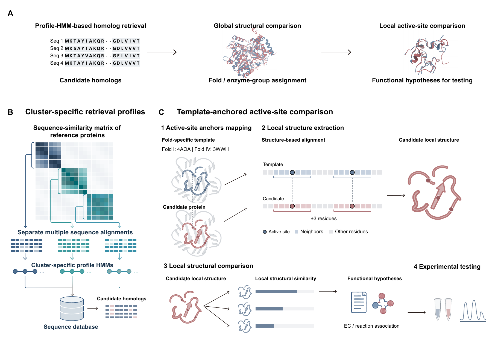

# Data and Code

Data and scripts accompanying *Matching Structural Scale to Functional Annotation Tasks in Enzyme Discovery*. The package covers Lal enzymes, ω-transaminases, experimental validation, and the CYP comparison of global structure and local substrate-binding regions (Figure 5).

## Framework



**Figure 1.** Sequence- and structure-guided enzyme mining: homolog retrieval, global structural comparison, and template-anchored local active-site comparison.

## Contents

| Directory | Contents |
|---|---|
| `data/lals_reference/` | 29 Lal references, 74 candidates, sequence and global structural similarity matrices, and profile HMMs |
| `data/omega_reference/` | 58 reference records, 52 candidates, sequence and structural similarity matrices, functional groups, and profile HMMs |
| `data/omega_pocket_range_current/` | Local similarity matrices and benchmark results for active-site windows ±3, ±5, ±7, ±10, ±15, and ±20 |
| `data/experimental_validation/` | Product-detection tables and analytical assets |
| `data/cyp_reference/` | 86 CYP references, reaction evidence, final structural matrices, Figure 5 statistics, and experimental case data |
| `structures/` | Global/local coordinates and experimental case structures |
| `scripts/` | Figure-generation and benchmark scripts |

File descriptions are provided in the directory READMEs. `source_manifest.csv` lists file sources and checksums.

## Figure–script correspondence

| Figure | Script |
|---|---|
| Figure 1 | Author-created schematic of the enzyme-mining framework |
| Figure 2 | `plot_lal_uniprot_branch.py` |
| Figure 3 | `plot_omega_local_advantage.py` |
| Figure 4 | `plot_experimental_validation.py` |
| Figure 5A–C | `analyze_cyp_function.py`, `plot_cyp_function.py` |
| Figure 5E | `plot_cyp_pocket_alignment.py` |
| Figure 5D/F analysis | `analyze_cyp_case.py`, `compute_cyp_tm.py` (experimental coordinates supplied; views composed by the authors) |
| Figure S1 | `plot_reference_spaces.py` |
| Figure S2 | `plot_omega_window_sensitivity.py` |
| Figures S3–S4 | `plot_experimental_evidence_si.py` |
| Figures S5–S7 | `replot_ta_vector_chromatograms.py` |

For Figure 5, A/B evaluate 58 single-label queries in seven classes against the complete 86-protein structural reference set; C uses 56 matched queries in six classes across three exclusion conditions. D/E/F describe the OleT_KM–P450BSβ experimental case. Scripts generate the individual A/B/C/E panels; D/F are author-composed structural views supported by the supplied coordinates and analysis. See the [CYP dataset README](data/cyp_reference/README.md) for cohort definitions, local extraction, statistics and case details.

## Running the scripts

Requirements: Python 3, NumPy, SciPy, Matplotlib, Pillow, Biopython, and scikit-learn. Optional: TM-align 20220412 for recalculating CYP structural alignments.

```bash
python -m pip install numpy scipy matplotlib pillow biopython scikit-learn
python scripts/plot_lal_uniprot_branch.py
python scripts/plot_omega_local_advantage.py
python scripts/plot_experimental_validation.py
python scripts/plot_reference_spaces.py
python scripts/plot_omega_window_sensitivity.py
python scripts/plot_experimental_evidence_si.py
python scripts/replot_ta_vector_chromatograms.py
python scripts/reproduce_benchmark.py
python scripts/analyze_cyp_function.py
python scripts/plot_cyp_function.py
python scripts/analyze_cyp_case.py
python scripts/plot_cyp_pocket_alignment.py
```

Run commands from the package root. Outputs are written to `figures/`. The benchmark script calculates group-balanced recovery, average precision, bootstrap confidence intervals, and paired sign-flip tests from the supplied matrices.

## Citation

Please cite the accompanying unpublished manuscript when using these data or scripts:

```bibtex
@unpublished{DaiGuEnzymeMining,
  author = {Dai, Yuzhuo and Gu, Ruo-Xu},
  title  = {Matching Structural Scale to Functional Annotation Tasks in Enzyme Discovery},
  note   = {Unpublished manuscript}
}
```
